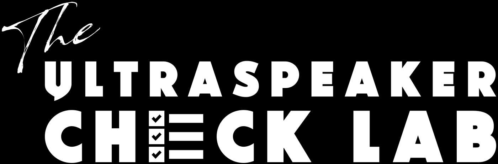

# The Ultraspeaker Check Lab

Controlla una presentazione PowerPoint (.pptx) o Keynote (.key) prima di consegnarla alla regia di un congresso: font, video e audio, immagini, formato e struttura, tempi, metadati EXIF delle foto. Crea il report con punteggio «Pronto per la regia», l’esportazione PDF, il nome del file per la regia, la checklist del giorno e i kit di prova video e immagini da aprire in sala.

- **Versione online** (PowerPoint e Keynote): https://niki977.github.io/ultraspeaker-check-lab/
- **Add-in PowerPoint** (Windows, Mac, web): `ultraspeaker-check-lab-manifest.xml`
- Interfaccia e pagine in italiano, inglese, spagnolo, francese e tedesco.

L’analisi avviene interamente nel browser o nel pannello di PowerPoint: la presentazione non viene mai inviata a server esterni.

## Struttura

```
index.html            versione online (.pptx e .key)
addin/taskpane.html   pannello dell’add-in PowerPoint
addin/commands.html   file di funzioni richiesto dal manifest
ultraspeaker-check-lab-manifest.xml   manifest dell’add-in (sideload e Marketplace)
guide.html, support.html, privacy.html, terms.html   pagine in 5 lingue
assets/css/app.css    stile condiviso
assets/js/            motore di analisi, interfaccia, traduzioni
assets/kit/           modello e file di esempio dei kit di prova
assets/icons/         icone 16–512 px (pittogramma della E-checklist)
assets/img/           logo Check Lab (bianco e nero, SVG e PNG), Arena
assets/fonts/         Champagne & Limousines (Nymphont): woff2 per l’interfaccia, ttf per il PDF
assets/vendor/        JSZip 3.10.1 (MIT), jsPDF 2.5.2 (MIT)
test/                 presentazione di prova con problemi voluti
```

## Immagine coordinata

Allineata al Brand Book di The Ultraspeaker: logo master con il descrittore CHECK LAB, in cui la E è una checklist a tre righe uguali; palette Stage Black; carattere Champagne & Limousines nell’interfaccia, nelle pagine e nel PDF; angoli 10 px, pulsante primario bianco, nessuna ombra, focus in blu #4F8DFF. Eccezione concordata: nel report Critico è rosso, Attenzione giallo, OK verde. Kit di prova: sfondo nero, Arena in basso a destra, testo in Arial per la massima compatibilità con i computer di regia.

© Nicholas D. Charles — The Ultraspeaker
